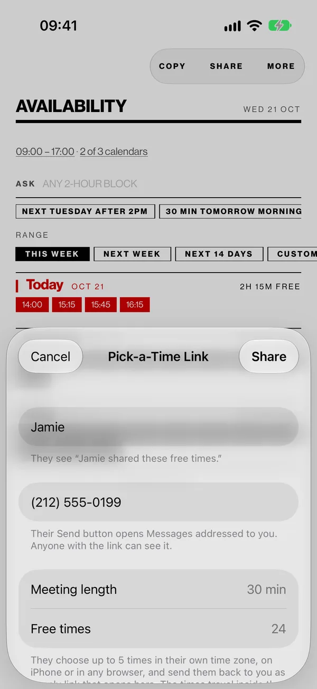
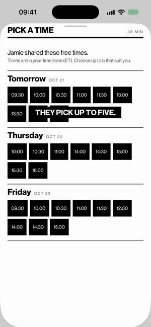
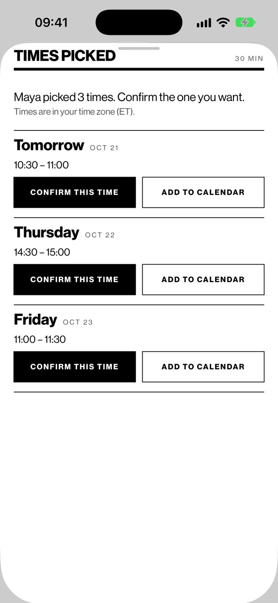
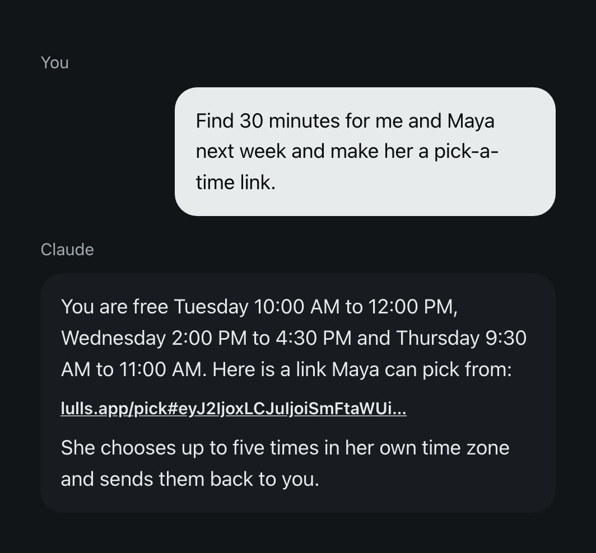
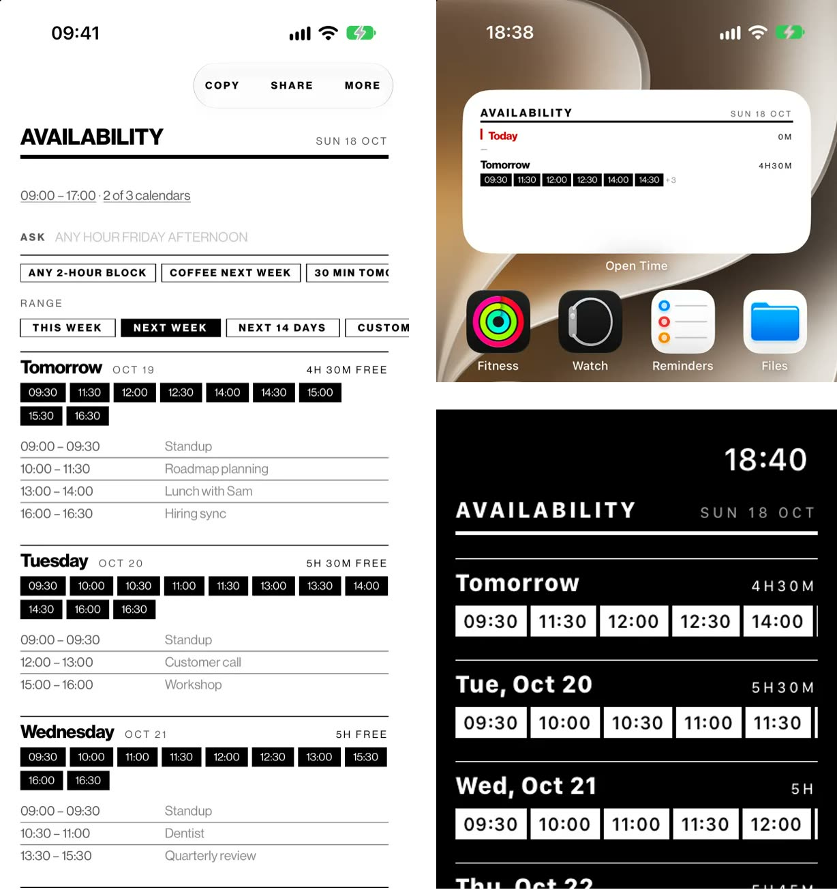
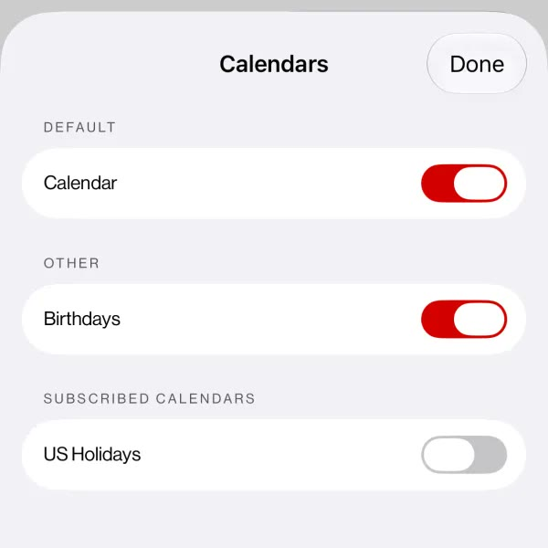
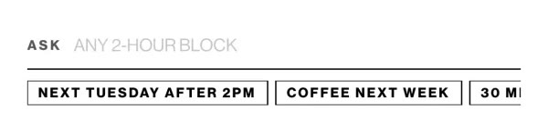

# OpenTime

See when you are free at a glance, and send it as a link the other person picks a time from. Your calendar stays on your iPhone.

$0.99, once. No subscription, no account. iPhone, iPad and Apple Watch. [lulls.app](https://lulls.app)

  
  
  

**You choose** the days, the meeting length and, if you like, your first name. **They pick** up to five times in their own time zone, in an App Clip on iPhone or in any browser, with nothing to install, and send them back. **You confirm** one in OpenTime and it goes on your calendar.

No more typing a list of times into a message that goes stale the moment either calendar moves, and no booking page that asks them to make an account.

## Or ask your assistant

If your assistant can see your calendar, like Claude with Google Calendar connected, it can find the gaps and send the link for you. Add OpenTime once, then ask in plain words. (The conversation above is an example.)

**Set it up:** in Claude, open Settings, then Connectors, and add a custom connector with the URL `https://lulls.app/mcp`. It works with any assistant that supports MCP.

**Make a link** from free time your assistant already knows, ready to paste into a message or an email. **Read one back:** paste a link or a reply someone sent you and it lists the times in your time zone, or checks them against your calendar.

The server stores nothing and never sees your calendar: the assistant hands it only the free times.

## Your week at a glance

Every free half hour between meetings, inside your working hours, as a row of times you can tap. Press and hold one to make an event there or copy it. The same answer sits on your Home Screen and on your wrist.

## Only the calendars that count

Leave out holidays, the kids' sports or a partner's shared calendar. Declined invites and events marked Free never count against you.

## Ask in plain words

"Next Tuesday after 2pm." "Coffee next week." "Any 2-hour block." Apple Intelligence works it out on the device, and the question never leaves your phone.

## Wherever you check the time

The Home Screen widget, a Live Activity and the Dynamic Island, Apple Watch, the iMessage app, the share sheet in any app, and Siri: "When am I free in OpenTime".

## Nothing leaves the phone

The app makes no network connections. There is no account, no analytics and no tracking. A pick-a-time link carries only the free times you chose, in the part of the URL a browser never sends to a server, and a reply carries only the times they picked.

## Build it yourself

Open `OpenTime.xcodeproj` in Xcode and run the `OpenTime` scheme (iOS 26.2 or later). The display font is licensed separately and not included, so the app uses the system font until you add your own copy. [DEVELOPMENT.md](DEVELOPMENT.md) covers the link format, the MCP server, the website and how the screenshots are made.

## License

The code is under the [MIT License](LICENSE). The Neue Haas Grotesk Display font is not included and not covered by it, and neither are the OpenTime name and app icon.
